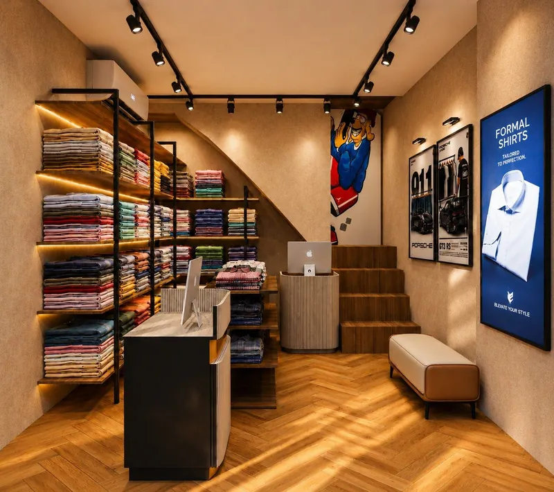
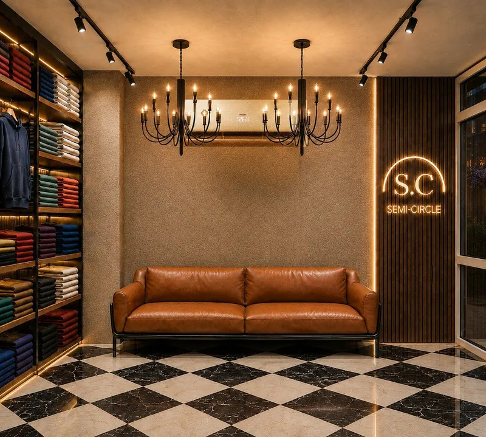
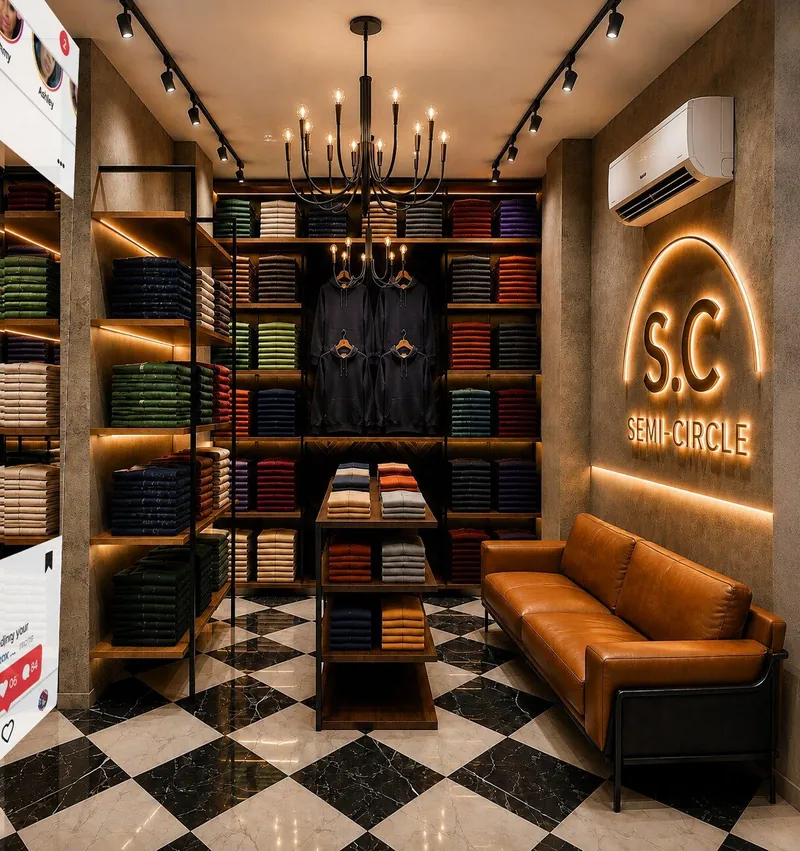

a small shop does not need more fixtures. it needs fewer, and better light on what it sells.

the patel nagar retail store is a two-floor menswear shop we are rebuilding around a younger customer. the brief was a fast, recognisable identity without a large footprint or heavy fixtures. good clothing store interior design at this size is mostly deciding where not to spend. the project is in progress, so every image here is a design render, not a site photo.

## 01 — the stock is the display

we pulled the fixtures back. the walls are shelving of folded shirts, lit from behind and along each shelf. the frame is thin black metal with timber shelves. there are no deep cabinets and no glass fronts.

folded colour, stacked and lit, reads from the pavement. a heavy carved fixture competes with the shirts and eats floor you cannot spare. in a small store, the product is the best-looking thing you own. light it and get out of its way.

if your budget is tight, this is where we would put it: light on the merchandise. we would take a plain shelf with good light over a costly shelf in shadow.

## 02 — let the floor and the counter carry the identity

if the shelving stays plain, something else has to make the shop recognisable. downstairs that job goes to two things: a herringbone wood floor and a fluted cash counter.

both are things a customer touches or walks on. both show up in every photo of the room. and neither takes a single shirt off the wall. we would rather spend on two strong surfaces than spread the same money across ten decorative details.

## 03 — in a two-floor shop, the stair is a sales tool

the upper floor of a small store usually dies. people shop the ground floor, pay and leave. the stair is often the reason. it sits behind a door or in a corner and feels like a route for staff.

the ground floor here is designed to move customers up the staircase naturally. in the renders the stair sits in plain view at the back of the shop. its treads are warm timber, in the same family as the floor, so it reads as part of the shop and not back-of-house.

if you are renovating a two-floor store, look at your stair before anything upstairs. if a customer cannot see it from the counter, the first floor will struggle whatever you put there.

## 04 — upstairs, one moment worth photographing

the ground floor is quick: read the wall, pick a shirt, move on. the first floor does the opposite. it slows people down around a branded lounge built to be photographed.

the pieces are few and strong: a checkerboard marble floor, candle chandeliers, a tan leather sofa and a backlit brand sign. for a younger customer, the phone camera matters as much as the rack. a photo with the sign in it carries the shop's name out of the shop.

notice that it is one moment, not five. a shop full of photo corners has none. pick the one wall, put the sign there, and keep the rest calm.

## 05 — a slow floor still has to sell

the lounge is not a waiting room. the same backlit shelving lines the first floor, and a central display table sits on the checkerboard marble. you can sit, and the stock is still within reach.

a sofa also does a quiet job in a menswear shop. it gives whoever came along somewhere to wait. a companion who is comfortable is a companion who does not rush the buyer out.

## before you renovate a small clothing store

- spend on light on the product before you spend on the fixture
- keep shelving thin and open so the merchandise is the display
- choose one or two strong surfaces, like the floor and the counter, to carry the identity
- make the stair visible from the counter if you have an upper floor
- give the upper floor one photo moment, not several
- ask your designer: what does a customer see from the pavement, and what makes them go upstairs?

see the full [patel nagar retail store project](/projects/patel-nagar-retail-store), our [commercial interior design](/services/commercial-interior-design) work, or how we work as an [interior designer in delhi](/delhi).
