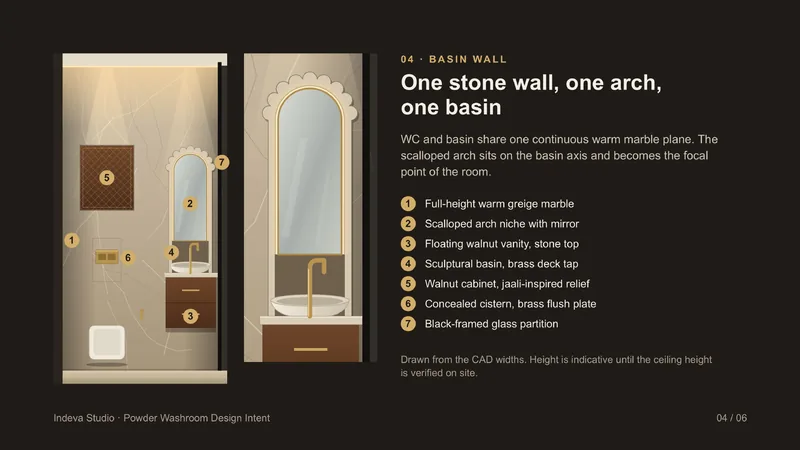
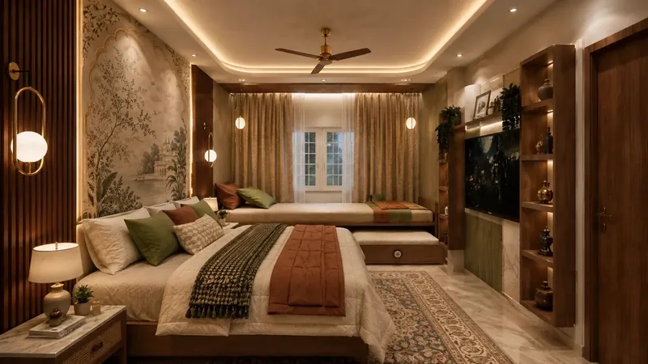
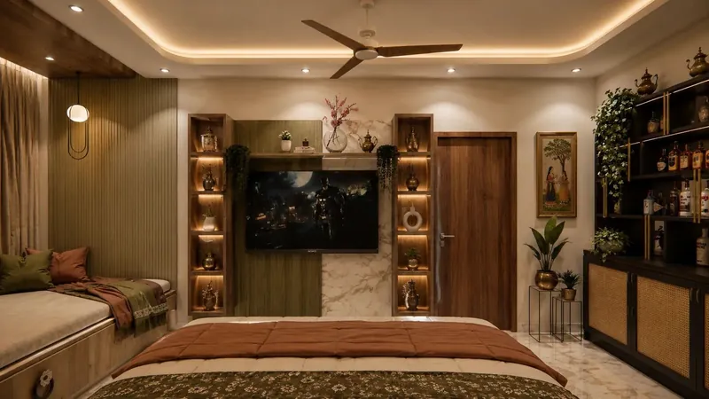
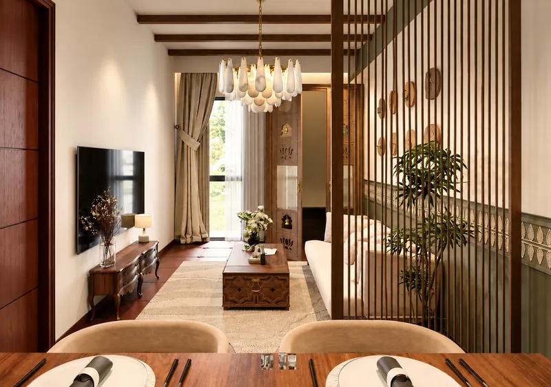
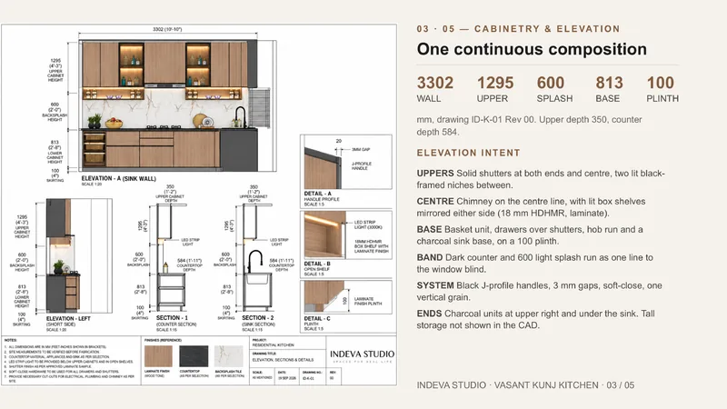

in a dda flat, the walls are mostly given. the design has to live in what you build against them.

that is the honest starting point for dda flat interior design. you rarely get to move much. so the money and the thinking go into two things: joinery and light. this residence in vasant kunj, new delhi, was designed room by room on that principle. the parents' bedroom was completed in 2025, in two months. the living and dining room, a modern bedroom, the kitchen and a powder washroom are in design development for 2026. every image below is a design render or a drawing from the design-intent sets, not a site photograph.

## 01 — accept the plan, then work inside it

the first decision in a dda flat is what not to change. in the powder washroom, the plan stays exactly where the existing cad drawing puts it. the wc and basin were not moved. instead, they share one continuous marble plane, with a scalloped arch framing the mirror on the basin axis. the room changes completely. the plumbing does not.

we would give the same advice to anyone renovating a dda flat. treat the walls and the wet areas as fixed until someone has checked them on site. then spend your effort on what sits in front of them.

## 02 — draw the joinery before anyone builds it

the parents' bedroom was resolved almost entirely through joinery. every element was detailed before site work started: the headboard wall, the arched upholstered headboard, the cane-front tv console, the cushioned window seat and the olive fluted tv panel with its marble inlay and display shelving.

this is where a small room is won or lost. a carpenter working without drawings builds what is easiest. in a dda bedroom, that usually means a wardrobe that blocks a window, a tv unit that fights the door, and storage that is deep where it should be shallow. drawn first, each piece is sized for the room it is in.

the design intent for the room was called "modern indian heritage": walnut and cane, sage and terracotta, brass and marble, with arches. none of it needed a structural change. all of it needed a drawing.

## 03 — layer the light, don't apply it

most flats are lit by a grid of ceiling lights added after the false ceiling is fixed. it gives you one mood: bright. in the parents' bedroom, the light was planned in layers instead. cove light washes the ceiling. panel sources do the general work. brass pendants hang either side of the bed.

the result is a room that moves from morning clarity to evening warmth without anyone thinking about it. the same idea runs through the modern bedroom, which uses 3000k cove and panel lighting, and the kitchen, with 3000k light under the upper cabinets.

## 04 — divide with a screen, not a wall

this living room is long and narrow, with dining at one end. the tempting move is to wall the two apart. we did the opposite. living and dining stay connected along one axis, separated by a slatted teak screen. you get two rooms in feeling and one room in light and air. the mandir sits in the entry threshold, so it has a place without taking a wall.

colour here comes from material, not paint: walnut, muted olive, terracotta and antique brass. paint fades and gets redone. a walnut panel or a terracotta floor holds its colour for as long as the flat stands.

## 05 — make the small rooms one composition

a kitchen in a flat has little length to waste. this one is drawn as a single composition across a 3,302 mm wall: solid shutters, two lit black-framed niches, and open shelves either side of the chimney. walnut-tone laminate carries the room. black stone and charcoal hold the edges. nothing is left for the site to decide.

the modern bedroom follows the same logic, planned in four zones: sleep at the bed wall, dressing by the window light, media on the tv wall, and reading on a window seat with storage below. a small room planned in zones feels larger than one planned around a bed.

## before you start on your dda flat

- ask what will not move. walls, wet areas and services first, design second.
- ask for joinery drawings before any carpenter is booked: elevations, sections, finishes.
- ask for a lighting plan with at least three layers, and the colour temperature written on it.
- ask whether a screen would do the job of the wall you want to build.
- ask to see the drawing set for one room before you approve the whole flat.

see the full [vasant kunj dda residence](/projects/vasant-kunj-dda-residence), our [residential interior design](/services/residential-interior-design) work, or how we work as an [interior designer in delhi](/delhi).
