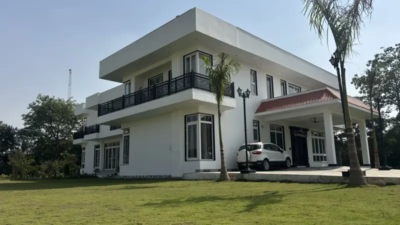
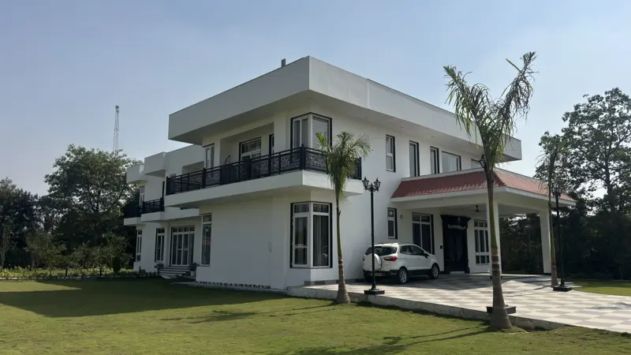
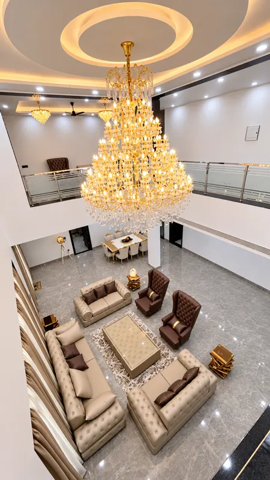
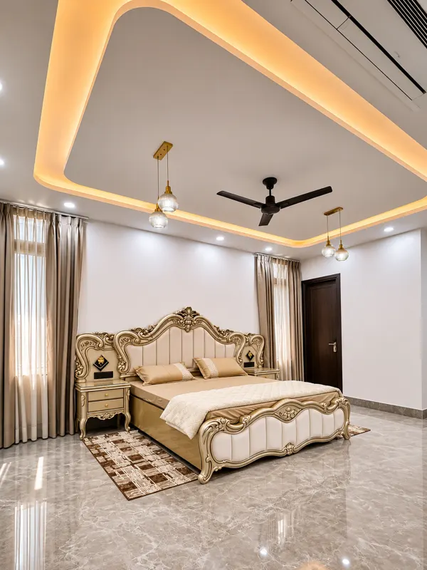
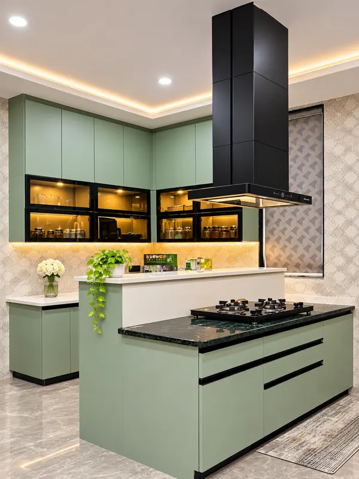

a farmhouse is judged by its living hall. it is decided by its ground.

casa bianca is a 10,000 sq ft neoclassical farmhouse in gurgaon, envisioned by the family as their white house: around ten bedrooms with attached bathrooms, a basement recreation area, an eight-shaped pool, wide balconies and landscaped gardens. the photographs show the chandelier and the carved beds. what they do not show is where most of the thinking went.

## the site sets the brief before the client does

remote farmhouse sites are not city sites with more land. on casa bianca we worked through summers of up to 45°C, frequent power cuts, scarce local supplies and costly transport for every truck that came in. each of these changes how a farmhouse should be designed, not only how it is built.

a detail that needs a specialist installer who is two hours away will be installed by someone else. a finish that needs a controlled temperature to cure will not get one in may. so the design has to be buildable in the conditions it will actually be built in. that is a design decision, and it is made on paper, early.

## 01 — the ground was the harder problem

the groundwater on this site is high and saline. that single fact touched almost every system in the house: basement waterproofing, structural integrity, drainage slopes, balcony levels and plumbing.

saline water does not just leak. it carries salts into concrete and plaster, and those salts come back out as damp patches and flaking paint long after handover. a basement that is waterproofed as an afterthought will show it within a few monsoons. on casa bianca, waterproofing was designed against groundwater pressure and long-term moisture, across the basement, the bathrooms, the balconies and the terrace, before any finish was chosen.

if you are planning a farmhouse, ask your designer one question before you look at a single moodboard: **what do you know about the water under this site?** if the answer is vague, the interiors will pay for it later.

## 02 — levels and slopes are design, not plumbing

wide balconies are the most enjoyable part of a farmhouse and the most common source of leaks. every balcony on casa bianca wraps generous outdoor space around the house, and every one of them had to drain away from the rooms behind it.

that means balcony levels, door thresholds and drainage slopes are drawn and fixed before the doors are ordered. get it wrong by a few millimetres and rainwater finds the bedroom floor. none of this appears in a rendering. all of it decides whether the house still feels new in five years.

## 03 — a vastu layout and ventilation first, neoclassical detail second

the family wanted grandeur. we gave it to them on top of a plan that works: a vastu-compliant layout, generous bedrooms and planned natural ventilation. neoclassical detailing is a language for the facade and the ceilings. it is not a reason to compromise the plan.

in a farmhouse that may sit empty for weeks, cross-ventilation is not a luxury. it is what keeps a closed house from smelling closed.

## 04 — one statement, then restraint

the living hall is double-height, with a tiered crystal chandelier set into a cove-lit ceiling. it is the one moment in the house designed to be looked at. around it, tufted seating and wing chairs are seen from a glass-railed gallery above.

the bedrooms each have their own character — a carved champagne-gold bed in one, a panelled headboard trimmed in brass in another — but they share the same quiet ceiling language and lighting logic. a house with ten bedrooms needs a system. without one, it becomes ten separate showrooms under one roof.

## 05 — the kitchen is chosen for the climate

the kitchen is a laminate-finished hdhmr kitchen in sage green, with a breakfast counter and a separate pantry behind rolling shutters. hdhmr earns its place here because it handles moisture better than most board materials — which matters in a house that sits on wet ground and, like most farmhouses, may stand closed between visits.

the pantry behind shutters keeps the working kitchen clear. when a farmhouse is full of guests, that separation is what lets the kitchen stay presentable while it is doing real work.

## 06 — outdoor details are measured, not ordered

the eight-shaped pool has granite coping that was custom-cut to follow its curves. standard coping stones on a curved pool leave triangular gaps filled with grout, which crack and stain. cutting each piece to the curve takes longer. it is also the reason the pool edge reads as one continuous line.

## what this means for your farmhouse

- investigate the site first: groundwater, soil, access, power, supply lines.
- fix waterproofing, levels and drainage in drawings before finishes are discussed.
- let ventilation and layout lead; let style follow.
- choose one statement space and build a calm system around it.
- pick materials for the climate and for weeks of the house standing empty.

see the full [casa bianca case study](/projects/casa-bianca-farmhouse-gurgaon), or read how we approach [farmhouse interior design](/services/farmhouse-interior-design) and [interior design in gurgaon](/gurgaon).
