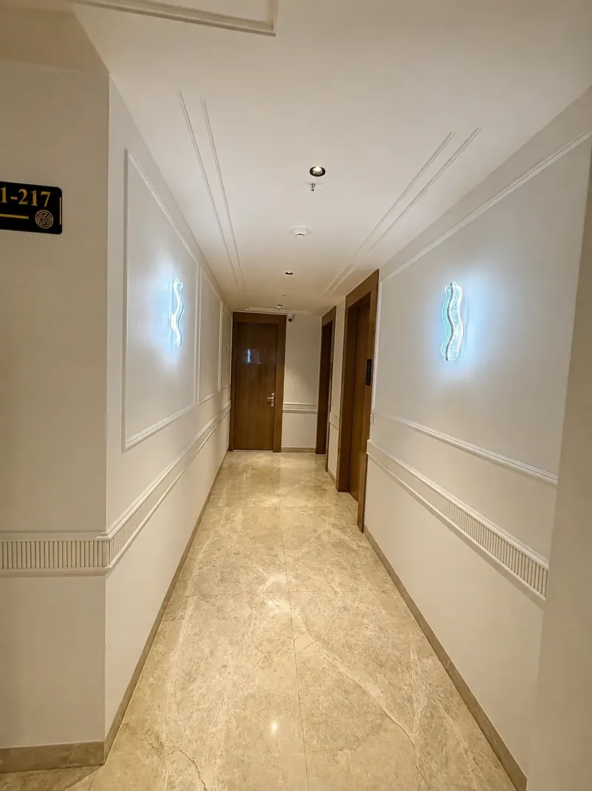
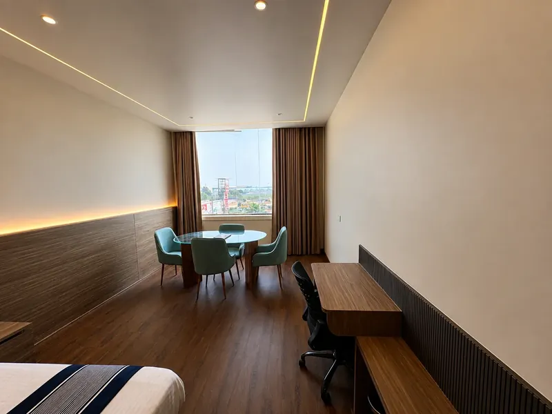
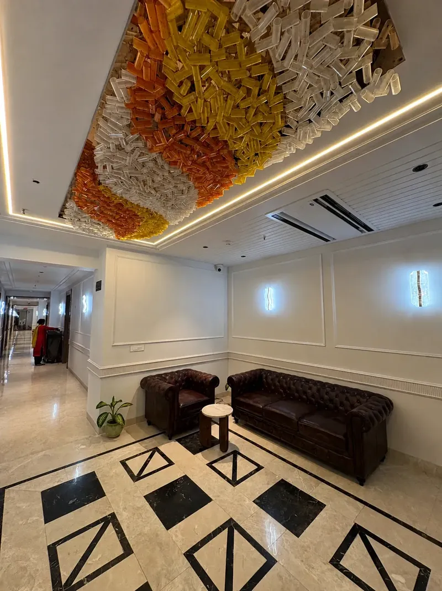
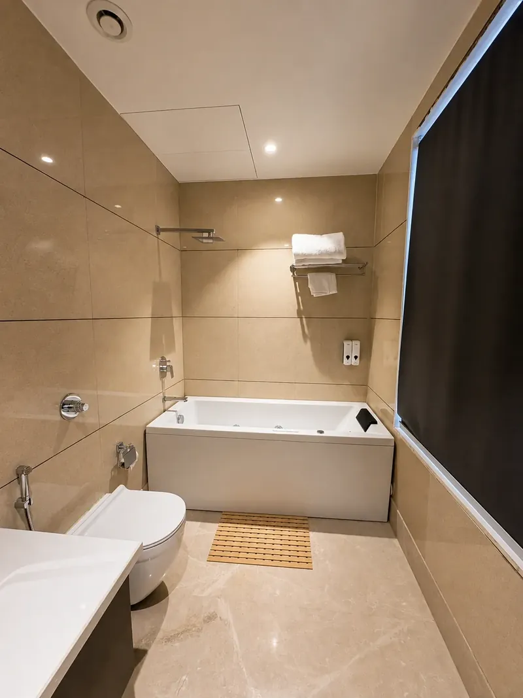
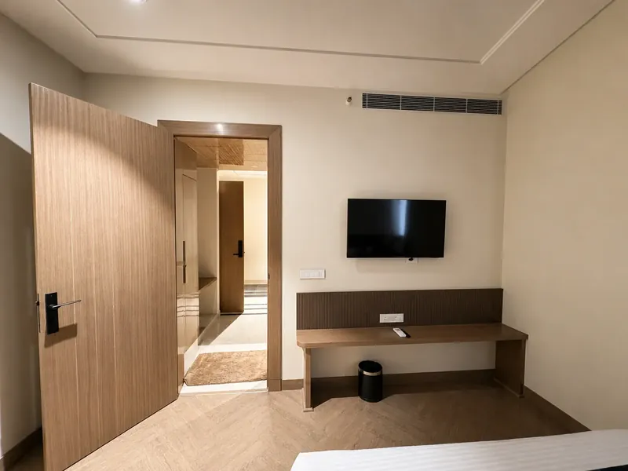

a hotel is the same room, built many times over. the design has to survive the repetition.

hotel silk by resham is a 23-room hotel on the murthal highway stretch near amrik sukhdev. we delivered it as a construction and interior project over twelve months, completed on 30 august 2026. the brief was simple to say and hard to do: a consistent, elevated guest experience across every room and the shared lobby, lounge and meeting spaces — without the palette feeling repetitive from one room to the next.

## 01 — three materials, decided early

we standardised a deliberately small material kit across every room and corridor: italian marble, mdf wall mouldings and pu-finished furniture. that is the whole list.

it sounds like a limitation. on a hotel it is a control system. when a material kit is fixed at the start, procurement becomes a handful of orders instead of twenty-three separate ones. carpenters repeat the same profiles until they are fast and exact. marble bought in as few lots as possible means one room matches the next. every decision made once is a decision that cannot drift on site.

## 02 — variation comes from light and layout, not more materials

a small kit only works if the rooms do not feel identical. so the variation is carried by things that cost little to change and much to get right: lighting and layout.

a guest who walks from the lobby to a suite moves through the same marble, the same mouldings and the same joinery finish. what changes is where the light falls, how the room is entered and what the window looks onto. one room has a window-side dining nook with a round table and velvet chairs. a suite bedroom has a tufted headboard and cane seating. each reads as considered, not templated.

## 03 — spend the drama in one place

the lobby is where a hotel makes its first and last impression, so that is where the one expressive element lives: a handcrafted glass ceiling installation in amber and clear tones. below it, chesterfield leather seating sits against an inlaid marble floor. everything else in the building stays calm, which is exactly why the lobby lands.

a small meeting room carries the same language at a smaller scale — marble with brass-legged seating — so business guests see the same hotel they checked into.

## 04 — bathrooms sell suites

in hospitality, the bathroom is often what a guest remembers and photographs. the suites have marble-clad bathrooms: one with a full jacuzzi, another with a soaking tub opening directly off the bedroom. italian marble is the same material used across the hotel, so the suites feel like the best rooms in the building, not like a different building.

## 05 — durability is a design brief

hotel rooms are used every night by people who will never see them again, so finishes have to be judged on how they wear. pu-finished furniture takes the knocks of luggage and housekeeping better than delicate surfaces. a patterned floor like herringbone at the room entry is forgiving where wear concentrates. moulded walls can be repainted without losing their character.

## if you are building a hotel or guest house

- fix the material kit before the first room is detailed — and keep it short.
- design one room completely, then repeat it; vary light and layout, not finishes.
- put the statement where every guest passes: the lobby.
- give suites better bathrooms, not different materials.
- specify for luggage, cleaning and nightly use, not for the opening photographs.

see the full [hotel silk case study](/projects/hotel-silk-murthal), our [hospitality interior design](/services/hospitality-interior-design) service, or how we deliver projects [from design to execution](/services/interior-design-execution).
