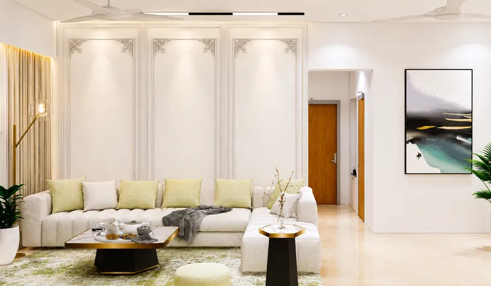
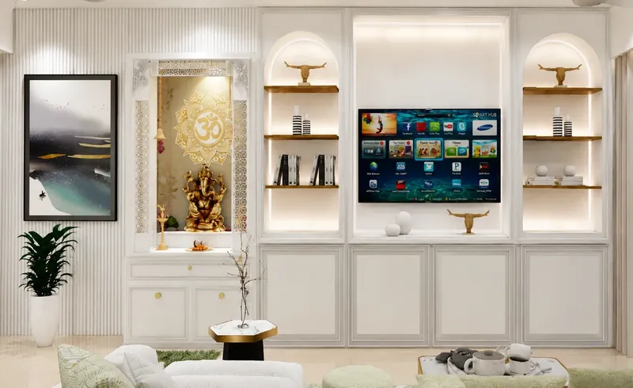
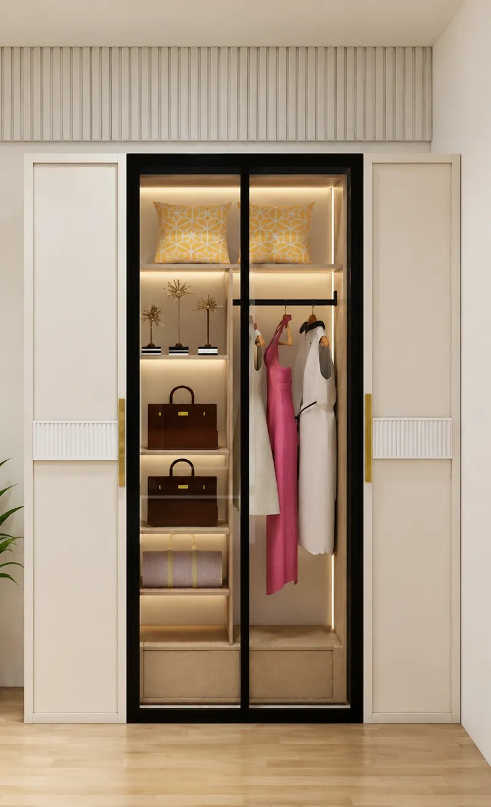
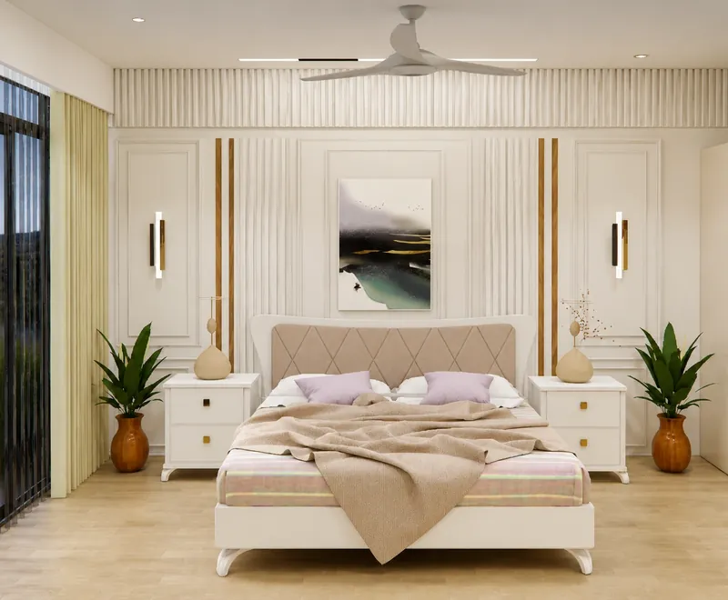
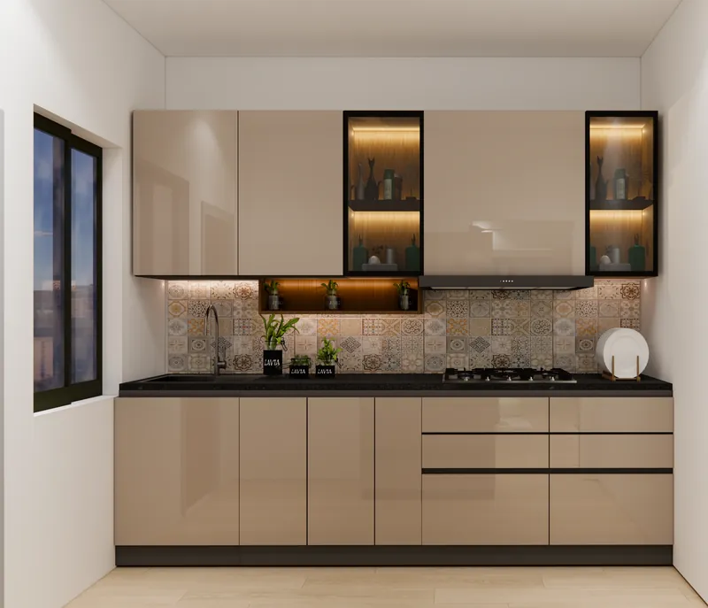

classical detail belongs to the walls. once it moves into the furniture, an apartment starts to feel like a museum.

this home in south delhi is a 2 bhk of 1,500 sq ft. the brief was to bring mouldings, panelled walls and fluted surfaces into it without the rooms turning ornate or impractical. that is the real test of neoclassical interior design in an apartment: not how much detail you can add, but where you let it sit. we designed the home and executed it turnkey, and it was completed in 2026. the images here are design renders from the drawing stage, not site photographs.

## 01 — neoclassical interior design starts with the walls

we put the ornament where the building would have had it: on the walls. the living room's sofa wall is divided into tall moulded panels, each with a carved detail at the top corners. that wall is the only ornate surface in the room.

a moulding fixed to a wall reads as architecture. it frames the room and then gets out of the way. the same profile on a sofa, a table and a mirror reads as decoration, and in a compact room decoration adds up fast.

## 02 — plain furniture is what stops it turning ornate

the period look usually goes wrong in the furniture. carved legs, gilt frames and deep button tufting are what make a classical room heavy. here, classical proportions on the walls are paired with streamlined, contemporary pieces: a low sofa in plain upholstery, simple side tables, a soft rug.

this is the trade we would make in any apartment. you keep the backdrop classical and let the furniture be of its time. the room still reads as classical, because the walls carry the style. it also stays easy to live in, clean and change.

what to keep, and what to leave out:

- keep: wall mouldings, panelled shutters, fluting, symmetry and a warm neutral palette.
- keep: one material accent, used sparingly. here it is a thin line of brass on the side tables.
- leave out: carved and gilded furniture, heavy layered curtains and ornate ceilings on top of panelled walls.

## 03 — storage is built into the panelling, not added later

in an apartment, storage is usually the largest thing in the room. if a wardrobe or tv unit arrives as a separate box, it fights the panelling. so every unit here was drawn as part of the wall.

the living room's media wall shows how. the tv sits in a panelled frame, with arched, lit shelf niches on either side. the cabinets below use the same moulded shutters as the wall. the pooja niche is part of the same composition, framed with jaali side panels and lit from within. nothing on that wall looks added.

the bedrooms follow the same rule. the wardrobe shutters are panelled, with a fluted band and brass handles. a glass section in the middle is lit from inside, so the full-height unit does not read as a solid block.

## 04 — mouldings only work when the light finds them

a moulding is a shadow line. under flat, even light it almost disappears. the lighting in the living room and both bedrooms is layered: ambient light for the room, accent light for the walls and niches, and functional light where you read or dress.

in the master bedroom, the bed wall combines moulded panels, fluting and thin wood strips. wall lights on either side of the bed throw light across that surface, so the profiles show. the ceiling stays plain, with slim linear lights. two detailed surfaces facing each other would compete.

our advice: fix the light positions on the same drawing as the panelling. if the electrician decides them later, a sconce lands in the middle of a panel.

## 05 — not every room has to be classical

the kitchen has no mouldings at all. it has clean, flat shutters and a patterned tile backsplash, because it is the room that is wiped down every day. the second bedroom has a window seat, a reading nook by the light.

a home does not need every room in the same register. the classical rooms are the ones you sit in. the working rooms are allowed to simply work.

## before you commit to the classical look

- ask your designer to show you which walls carry detail and which stay plain. if the answer is "all of them", push back.
- ask to see wardrobes and tv units drawn as part of the panelling, on the same elevation.
- ask where every wall light and accent light sits on that drawing.
- choose furniture after the walls are drawn, and choose it plainer than you think.
- decide early which rooms stay simple. the kitchen is usually the first.

see the full [south delhi neo-classical residence](/projects/south-delhi-neoclassical-residence), our [residential interior design](/services/residential-interior-design) work, or how we work as an [interior designer in south delhi](/south-delhi-interior-designer).
