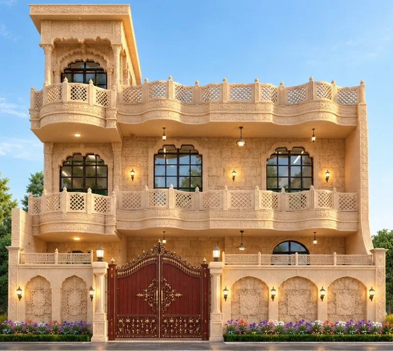
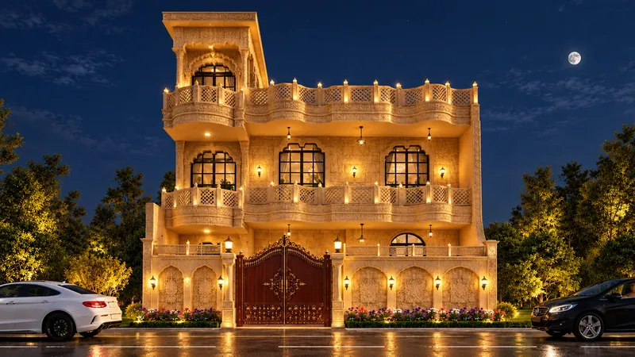
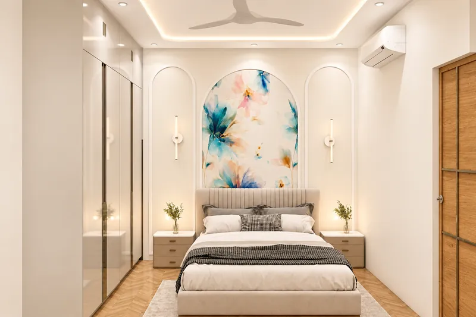
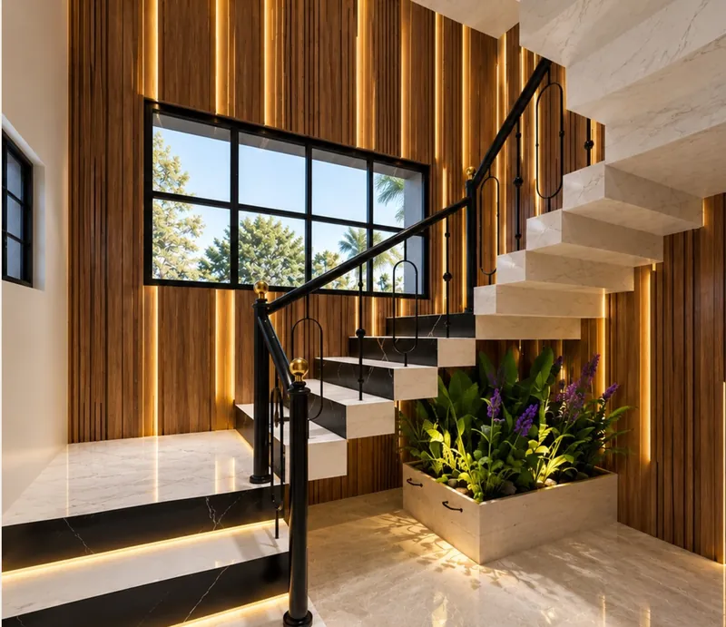

most old houses are not demolished because they have failed. they are demolished because no one checked whether they had.

this family home in narela was built some 35 years ago. the easy advice would have been to pull it down and start again. instead, the house is being kept and renewed — a new dholpur stone facade outside, a strengthened structure underneath, and complete interiors inside, from the entrance lobby to every bedroom, washroom and the staircase. the project is ongoing; the images below are the design as drawn and rendered for site.

## 01 — check the structure before you draw a single room

a 35-year-old house was designed for the loads of 35 years ago. a new stone facade, a rebuilt staircase and moved walls all change the loads. so before any of them were added, the existing footings and columns were checked with a structural consultant.

the strengthening that followed is specific, not general: foundation details, column jacketing with micro-concrete and new ties, and rcc work where walls and the staircase changed. none of it will ever be seen. all of it is the reason the rest of the design is safe to build.

if you are considering renovating an older home in delhi, the first expense should be an honest structural assessment. it is the cheapest decision in the project and the one that tells you whether every other decision is possible.

## 02 — a facade in dholpur stone, drawn by day and by night

the front was redrawn in dholpur stone, the warm sandstone of rajasthan: arched windows, carved balconies, chhatri details on the roofline and a new main gate.

we rendered the facade twice — once in daylight, once at night. a carved stone face is defined by its shadows. if the lighting is added after the stone is fixed, the fittings end up wherever the electrician finds a wire. drawing the night view first meant every light position was planned with the carving, not drilled into it later.

## 03 — every room gets drawings, not just a render

a render tells a family what a room will feel like. a drawing tells a carpenter what to build. on this house, every room has its elevations, false ceiling, electrical and plumbing drawings for site. that is the difference between a design that is approved and a design that is executed.

the living room centres on a tv wall with a backlit jaali mandir unit, botanical wallpaper in moulded frames and a fluted column marking the passage. the seating side uses brass-framed cane screens to divide the space without closing it.

## 04 — one family, three bedrooms, three characters

a renovation is a chance to design for the people who live in the house now, not the family it was built for 35 years ago. the master bedroom has blossom wallpaper above moulded wainscot, with a walk-in wardrobe beyond. the son's bedroom has a sculpted mountain-relief wall above a wave-shaped, cove-lit headboard, with a study desk on the tv wall. the daughter's bedroom has a watercolour floral mural set in a white arch behind a tufted headboard.

each room is different on the surface. underneath, they share the same discipline: one feature wall, a controlled ceiling, and lighting that is drawn, not improvised.

## 05 — the staircase as the spine of the house

in an older house, the staircase is often the most dated element and the hardest to change. here it is rebuilt in granite treads, a black ms railing and tall wood-tone feature lines, with light built into each tread and along the wall for a calm glow at night. because the staircase changed, it is also one of the places where new rcc work was required — which is why the structural check came first.

## when renovating beats rebuilding

- the structure can be assessed and strengthened rather than replaced.
- the family wants to stay on the same plot and keep the house's history.
- the plan works, or can work with a few changed walls.
- the budget is better spent on facade, services and interiors than on demolition and new foundations.

when those are true, a 35-year-old house can feel new from the street to the last bedroom. see the full [villa project, narela](/projects/villa-narela), our [residential interior design](/services/residential-interior-design) work, or how we work as an [interior designer in narela](/locations/narela).
