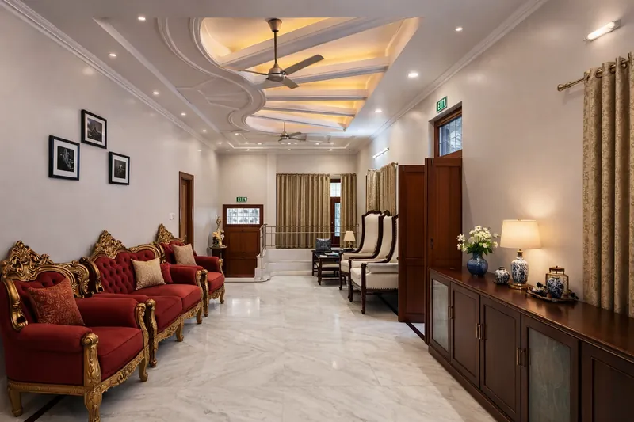
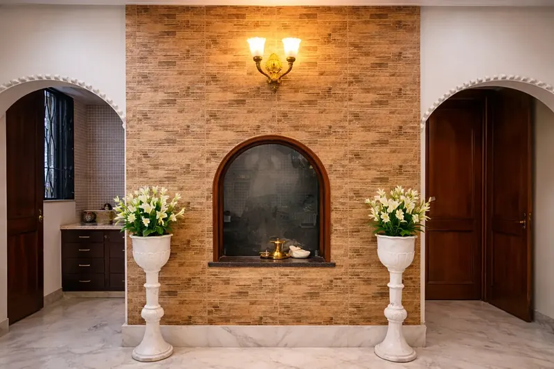
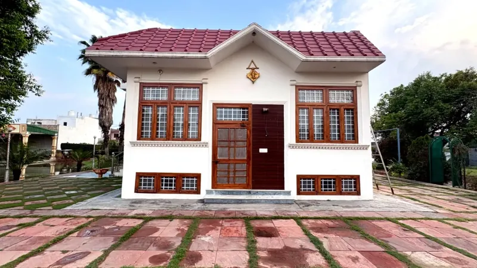

a small farmhouse is one big room with a whole family inside it. the plan's job is to give each of them a place without putting up walls to do it.

this project in delhi is a 4,800 sq ft farmhouse residence. we did the interior design, the custom furniture and the site execution, over 5 months, and it was completed in 2024. the family wanted a home that holds light without chasing it: rooms sized for use rather than impression, and every surface chosen once. the hard part was the volume itself. small farmhouse design in india usually comes down to this problem: a large open plan that still has to give each part of the household its own identity. the images here are site photographs.

## 01 — small farmhouse design is a zoning problem, not a size problem

a farmhouse plot invites one big hall. it feels generous on the first visit. in daily life it gives nobody a place of their own: the person reading, the people eating and the person going to bed all share one space and one light.

the usual fix is partitions. that is also the usual mistake. a wall across an open volume kills the sightlines that made the house worth building, and the rooms on either side end up smaller than they should be.

here, the one large volume is organised into distinct zones for living, dining and the bedrooms, without breaking sightlines or adding partitions. the zones are decided first. the walls, where they exist, come after.

## 02 — the structure drew the plan before we did

the layout followed the structure first. this sounds obvious. on a farmhouse it often isn't done, because the open hall tempts you to place furniture wherever it looks best on the day.

we would always start from where the columns and beams fall. those lines are already in the room, and they are where the edge of a zone reads naturally. draw a seating area that ignores them and you get a beam running across its middle, which no ceiling detail fully hides.

## 03 — arrival is a sequence, not a door into the hall

the plan moves from an entrance foyer to a lobby and then into the living area. nobody walks straight from the lawn into the middle of the house. each step is a little more private than the one before.

the living lobby shows how a zone is made without a wall. the floor runs through in one pale veined finish. the seating group sits under a curved, stepped ceiling cove with concealed light. further along, a second group of chairs, and then a few steps up mark the next part of the house. doors along the side lead off the room rather than cutting across it.

our view: in an open plan, zones are drawn on the ceiling and in the floor levels. walls are the last tool, not the first.

## 04 — the working rooms sit at the edge

the kitchen, the utility and the bedrooms are arranged around the living area. that is what keeps the middle open. cooking, washing and sleeping all need doors at some point. put them at the edge and the doors never interrupt the main volume.

the kitchen and utility zone is reached through arched openings. between them, a tile-clad wall with a lit arched niche gives the threshold something to look at. you see a composed wall from the living side, not the kitchen counter.

## 05 — every dimension was on paper before site work began

every material and dimension was locked into working drawings before site work began, so nothing on site was decided by improvisation.

this matters more in an open plan than in a house of closed rooms. when you can see across the whole volume, a door head that is slightly off or a ceiling line that steps in the wrong place is visible from everywhere. in a closed room the same mistake hides behind a door.

the outside follows the same discipline. on the elevations, window frames line up at the same heights, and the timber frames repeat across the facade. that kind of order is decided on a drawing. it is very hard to arrive at on site.

## before you plan a small farmhouse

- ask your designer to show the zones on the plan before any wall is drawn. living, dining and sleeping should each have a clear edge.
- ask where the columns and beams fall, and check that the zone edges follow them.
- walk the arrival on paper: lawn, foyer, lobby, living. each step should feel a little more private.
- keep the kitchen, utility and bedrooms at the edge of the main volume, behind their own doors.
- don't let site work start until materials and dimensions are on working drawings. in an open plan, every error is on show.

see the full [mini farmhouse project](/projects/mini-farmhouse-delhi), our [farmhouse interior design](/services/farmhouse-interior-design) work, or how we work as an [interior designer in delhi](/delhi).
