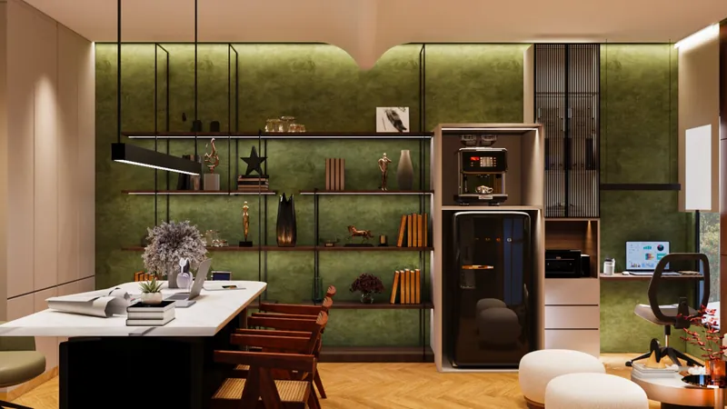
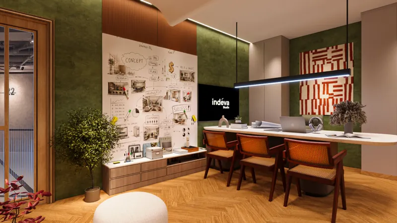
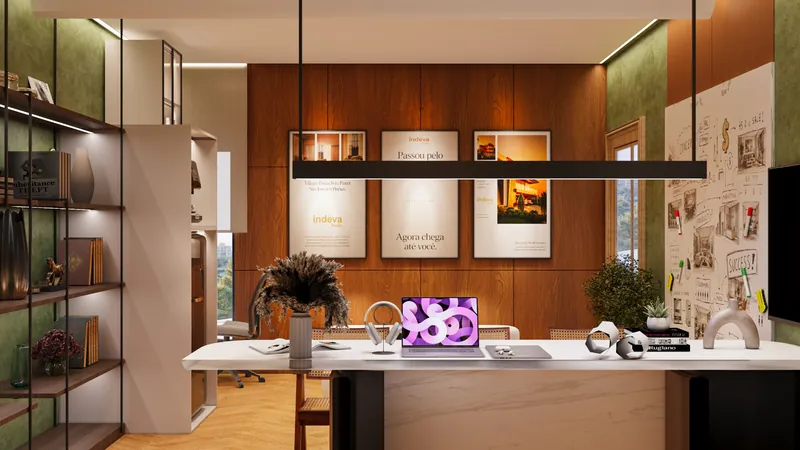
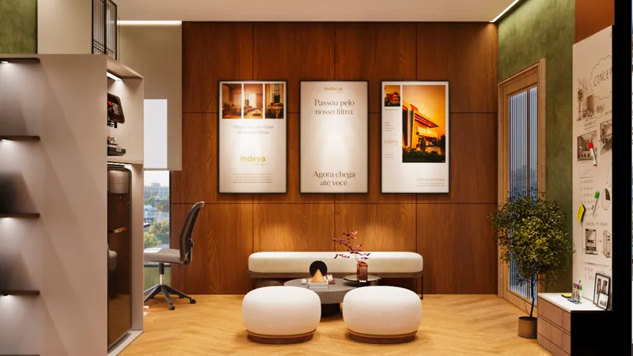

a small office does not run out of space. it runs out of walls.

our own office in narela is one room, 14'6" wide with a 10 ft ceiling. it has three jobs: a place to work, a place to sit down with clients, and a library of material samples. small office interior design is mostly the discipline of giving each of those jobs a wall before anything is bought. the design, by yakshita katyal in our studio, is complete with a full drawing set for site. the images here are design renders.

## 01 — give every wall one job

in a single room, the furniture does not decide the layout. the walls do. so before choosing a chair, we wrote down what each wall had to carry.

the left wall took the working kit: the work desk, the printer, the pantry unit and the whiteboard. the right wall took presentation: the tv and an open sample rack. the entry took two wardrobes for files. the window got the soft seating. the centre of the room was left for one thing only, the meeting table.

once every wall has a job, nothing ends up on a wall by accident. that is what stops a small office from feeling crammed.

## 02 — test the layout four times on paper

before fixing any furniture, we tried four layouts in the same room. each one moved the seating, the table and the work desk around the window and the door.

this is cheap to do in drawings and expensive to do on site. a desk that blocks the door swing, or a table that leaves no room to pull a chair back, is invisible in a mood board. it is obvious in a plan drawn to scale. four options cost some drawing time. getting it wrong would have meant living with it every day.

## 03 — a 10 ft table in the middle, not a desk in the corner

the final plan puts a 10 ft stone-top table at the centre, with cane-back chairs, and a long black linear light running its full length. it is where we work, where clients sit, and where drawings get spread out.

in a small office, a large shared table works harder than several small desks. it holds more people when a client visits, and it keeps the floor open the rest of the time. the pin-up wall and the tv face it, so drawings are discussed right where they hang.

## 04 — warm, not white

most small offices are painted white to look bigger. they end up looking like a waiting room. we wanted the room to feel settled, like a place you would happily sit in for a two-hour meeting.

the base is olive textured walls and walnut veneer panelling with 6 mm grooves. herringbone oak runs underneath. black metal keeps the shelving and lights crisp, and white stone tops with white ottomans lighten the room where it needs it. rust and cane come in through the chairs and the artwork.

we rendered the display wall in navy, off white and beige before choosing olive. seeing the options side by side, in the actual room, is how a colour decision should be made. a swatch on a phone screen is not enough.

## 05 — soft seating that moves

the seating corner by the window uses white ottomans rather than a fixed sofa. they are easy to pull around when more people come in, and they push back against the wall when they don't. a stretch ceiling sits above this corner, which separates it from the working zone without adding a partition.

## 06 — draw it fully, even for one room

a small project is not a reason for fewer drawings. the drawing set for this one room covers the wall elevations, the ceiling and lighting plan, electrical and ac layouts, cctv points, the outer wall with fluted panels and a signage light, and a compact 4 ft washroom.

the lighting plan alone has a stretch ceiling, a curved pop drop between the two zones, a cove light, 18 polo lights and 6 adjustable spots. none of that can be improvised by an electrician on the day. in a small room, every light that lands in the wrong place is noticed.

## before you fit out a small office

- list the jobs the room must do, then give each one a wall
- draw at least three layouts to scale before buying furniture
- choose one shared table over several small desks if clients visit
- pick a palette you would sit in for two hours, not one that looks big in a photo
- get a ceiling, lighting and electrical drawing, even for one room

see the full [indéva studio office project](/projects/indeva-studio-office-narela), our [commercial interior design](/services/commercial-interior-design) work, or how we work as an [interior designer in narela](/locations/narela).
